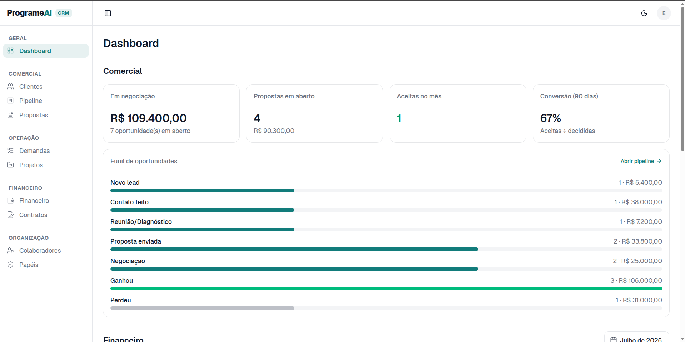
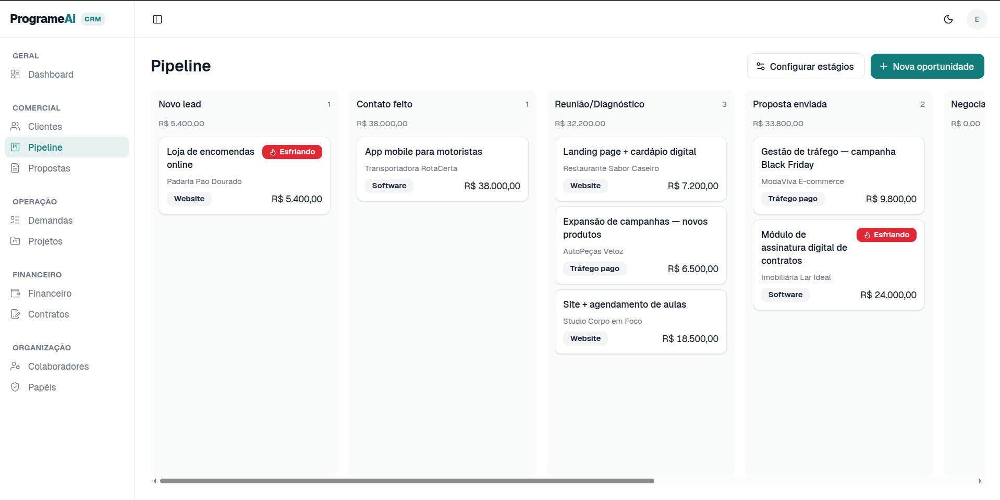
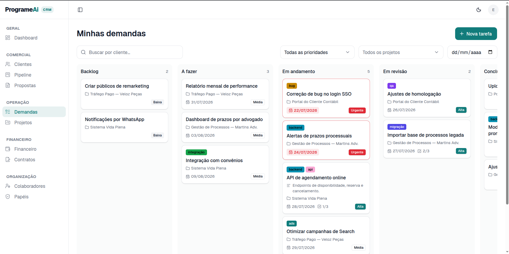
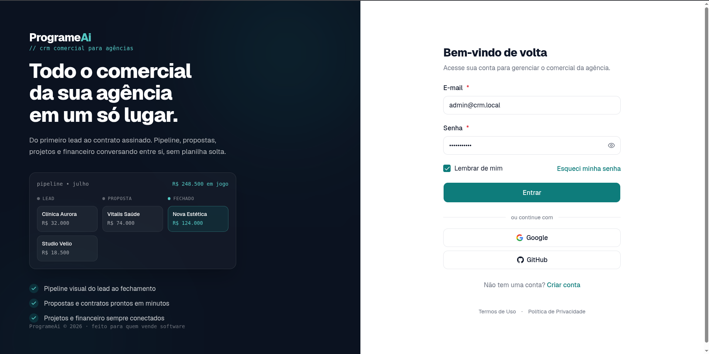

<div align="center">

# ProgrameAi CRM

**Todo o comercial da sua agência em um só lugar.**
Do primeiro lead ao contrato assinado — pipeline, propostas, projetos e
financeiro conversando entre si, sem planilha solta.

[](./LICENSE)
[](https://nestjs.com)
[](https://react.dev)
[](https://www.postgresql.org)

[Funcionalidades](#funcionalidades) ·
[Telas](#telas) ·
[Começando](#começando) ·
[Autohospedagem](#autohospedagem) ·
[Contribuindo](#contribuindo)

</div>

---

## Sobre

CRM open source para **agências e estúdios de software**: o mesmo lugar onde a
oportunidade entra é onde ela vira proposta, contrato, projeto e receita
recorrente. Feito para quem hoje espalha esse fluxo entre planilha, Trello e
caderno.

Uma instância atende **vários owners**. Cada owner é dono dos seus dados —
isolamento garantido no banco por Row Level Security, não só na aplicação — e
convida colaboradores com papéis e permissões granulares.

## Funcionalidades

| Módulo | O que faz |
| --- | --- |
| **Clientes e contatos** | Cadastro, histórico de atividades e contatos por cliente |
| **Pipeline** | Funil visual com estágios configuráveis, valor por estágio e alerta de oportunidade esfriando |
| **Propostas** | Montagem de proposta, envio, aceite/recusa e expiração automática |
| **Contratos** | Contrato a partir da proposta aceita, com programação de mensalidades |
| **Projetos e demandas** | Quadro de tarefas por projeto, com prioridade, prazo, checklist e etiquetas |
| **Financeiro** | Mensalidades, cobranças, vencidos e visão mensal |
| **Colaboradores e papéis** | Convite por e-mail, papéis com permissões granulares e desativação de acesso |
| **Dashboard** | Comercial e financeiro num painel só, respeitando as permissões de quem olha |

Transversal ao produto: autenticação JWT com refresh em cookie `httpOnly`,
login social (Google e GitHub), captcha opcional no cadastro, redefinição de
senha por e-mail, rate limit por cliente e **log estruturado em JSON** pronto
para Loki/Grafana.

## Telas

<div align="center">

**Dashboard** — comercial e financeiro no mesmo painel


**Pipeline** — funil visual do lead ao fechamento


**Demandas** — quadro de tarefas por projeto


**Login** — com senha ou provedor social


</div>

## Stack

- **Backend:** NestJS 11 + Prisma (monólito modular)
- **Frontend:** React + Vite + Tailwind CSS v4 + shadcn/@base-ui
- **Banco:** PostgreSQL 16 com Row Level Security por `ownerId`
- **Monorepo:** pnpm workspaces

## Começando

### Pré-requisitos

- **Node.js 20.19+ ou 22.12+** (exigência do Vite 8; desenvolvido na 24)
- **pnpm 9** — `corepack enable && corepack prepare pnpm@9.15.0 --activate`
- **Docker** e Docker Compose, para o Postgres local

### Passo a passo

**1. Clone e instale as dependências**

```bash
git clone https://github.com/programeai/CRM.git
cd CRM
pnpm install
```

**2. Suba o Postgres**

```bash
pnpm db:up          # docker compose up -d — Postgres 16 em localhost:5435
```

**3. Crie os arquivos de ambiente**

```bash
cp apps/api/.env.example apps/api/.env
cp apps/web/.env.example apps/web/.env
```

Os defaults já apontam para o Postgres do passo anterior. Nada precisa ser
editado para rodar local — OAuth, captcha e SMTP ficam em branco e se desativam
sozinhos.

**4. Aplique as migrations e o dataset de demonstração**

```bash
pnpm --filter api prisma migrate dev
pnpm --filter api prisma db seed
```

O seed cria um dataset completo (clientes, oportunidades, propostas, projetos e
financeiro) para você navegar por todas as telas com dados plausíveis.

**5. Suba a aplicação**

```bash
pnpm dev            # api em :3000/api/v1 · web em :5173
```

Abra **http://localhost:5173** e entre com:

| E-mail | Senha |
| --- | --- |
| `admin@crm.local` | `changeme123` |

> Credenciais de demonstração. **Troque-as** antes de qualquer uso real.

### Problemas comuns

| Sintoma | Causa e solução |
| --- | --- |
| `EADDRINUSE: address already in use :::3000` | Outra aplicação já ocupa a porta. Rode com `PORT=3100 pnpm dev:api` ou libere a 3000. |
| `Can't reach database server at localhost:5435` | O Postgres não está no ar: `pnpm db:up`. Confira com `docker compose ps`. |
| Migration pendente após dar `git pull` | `pnpm --filter api prisma migrate dev` aplica o que falta. |
| Front carrega mas toda chamada falha | `VITE_API_URL` no `apps/web/.env` precisa apontar para a API (`http://localhost:3000/api/v1`). Variável `VITE_*` é lida em build-time: reinicie o dev server após mudar. |

### Comandos úteis

```bash
pnpm dev                              # api + web em paralelo
pnpm dev:api                          # só a API (watch)
pnpm dev:web                          # só o front
pnpm --filter api test                # suíte de testes da API
pnpm --filter api build               # compila a API
pnpm --filter web lint                # oxlint no front
pnpm --filter api db:reset            # recria o banco do zero (destrutivo)
pnpm db:down                          # derruba o Postgres
```

## Autohospedagem

Rodar sua própria instância é **gratuito e não exige licença nenhuma**.

O [`docker-compose.selfhost.yml`](./docker-compose.selfhost.yml) sobe o CRM
inteiro numa VPS onde só exista Docker: front, API, Postgres e um **reverse proxy
com HTTPS automático** (Caddy). Ele compila as imagens a partir deste
repositório, então não depende de registry nem de proxy pré-existente.

**Precisa de:** uma VPS com 2 GB de RAM, Docker, e um domínio com registro **A**
apontado para ela (as portas 80 e 443 abertas).

```bash
git clone https://github.com/programeai/CRM.git && cd CRM

./scripts/gerar-env-autohospedagem.sh   # cria o .env já com segredos fortes
nano .env                               # preencha CRM_DOMAIN e ACME_EMAIL

docker compose -f docker-compose.selfhost.yml up -d --build
```

O primeiro `--build` leva de 5 a 15 minutos. Quando os quatro containers
estiverem saudáveis, abra `https://<seu-dominio>/registrar` e crie sua conta — a
primeira conta é a **owner** da instância, e não existe usuário padrão em
produção. **Depois feche o autocadastro** (`REGISTRATION_ENABLED=false` + `up -d`),
ou qualquer pessoa com o endereço cria conta na sua instância.

O guia completo — requisitos, topologia, backup, atualização, segurança e uma
tabela de problemas comuns — está em
**[docs/autohospedagem.md](./docs/autohospedagem.md)**.

As migrations são aplicadas automaticamente a cada start da API.

<details>
<summary><strong>Já tem um Traefik no host?</strong></summary>

Então o [`docker-compose.prod.yml`](./docker-compose.prod.yml) é a base mais
próxima do que você quer: é o deploy usado pelo mantenedor, com imagens vindas
do Docker Hub e o TLS delegado a um Traefik já configurado (rede externa
`traefik-proxy` + resolver ACME). Ele **não** funciona copiado e colado — as
imagens estão sob o `DOCKERHUB_USERNAME` de quem publicou. Troque `image:` por
`build:` como no selfhost, ou publique as suas. Contrato de variáveis em
[`.env.example`](./.env.example) e pipeline em
[docs/deploy.md](./docs/deploy.md).

</details>

## Documentação

| Documento | Conteúdo |
| --- | --- |
| [docs/autohospedagem.md](./docs/autohospedagem.md) | **Subir sua própria instância numa VPS** (start aqui) |
| [docs/deploy.md](./docs/deploy.md) | Deploy do mantenedor: Traefik, secrets, pipeline e rollback |
| [docs/observabilidade.md](./docs/observabilidade.md) | Log estruturado, consultas prontas e `x-request-id` |
| [docs/billing-stripe.md](./docs/billing-stripe.md) | Integração de assinatura via Stripe (opcional) |
| [apps/api/ENDPOINTS.md](./apps/api/ENDPOINTS.md) | Referência de todos os endpoints da API |
| [CLAUDE.md](./CLAUDE.md) | Regras de arquitetura do projeto |
| [ROADMAP.md](./ROADMAP.md) | O que vem por aí |

## Contribuindo

Contribuições são bem-vindas — correção de bug, melhoria de UX, documentação ou
funcionalidade nova.

1. Leia o **[CONTRIBUTING.md](./CONTRIBUTING.md)** e o
   **[Código de Conduta](./.github/CODE_OF_CONDUCT.md)**.
2. Abra uma **issue** antes de mudanças grandes, para alinhar a abordagem —
   temos [templates de bug e de melhoria](./.github/ISSUE_TEMPLATE).
3. Faça um fork, crie sua branch e mande o PR. O
   [template de PR](./.github/PULL_REQUEST_TEMPLATE.md) traz o checklist.

Duas convenções que pegam quem chega:

- **Toda mensagem visível ao usuário é em pt-BR** — validações, toasts, exceções
  da API e textos de UI. Código, tabelas e endpoints ficam em inglês.
- **Commits em pt-BR** no formato `tipo(escopo): descrição no imperativo`, e
  mexer em controller significa atualizar `apps/api/ENDPOINTS.md` no mesmo PR.

Antes de abrir o PR: `pnpm --filter api test` e `pnpm --filter api build`.

### Segurança

**Não abra issue pública para falha de segurança.** Use o
[reporte privado de vulnerabilidade](https://github.com/programeai/CRM/security/advisories/new)
— detalhes e escopo em [SECURITY.md](./.github/SECURITY.md).

## Licença

Distribuído sob a **[Apache License 2.0](./LICENSE)**. Você pode usar, modificar,
autohospedar e vender versões derivadas.

### Marca (Trademark)

O **código** é livre, mas os nomes **"ProgrameAi"** e **"ProgrameAi CRM"**, o
logo e a identidade visual (teal `#0E7C7B`) **não são licenciados**. Forks e
produtos derivados devem usar nome e identidade próprios e não podem sugerir
afiliação ou endosso oficial. Ver [NOTICE](./NOTICE).
